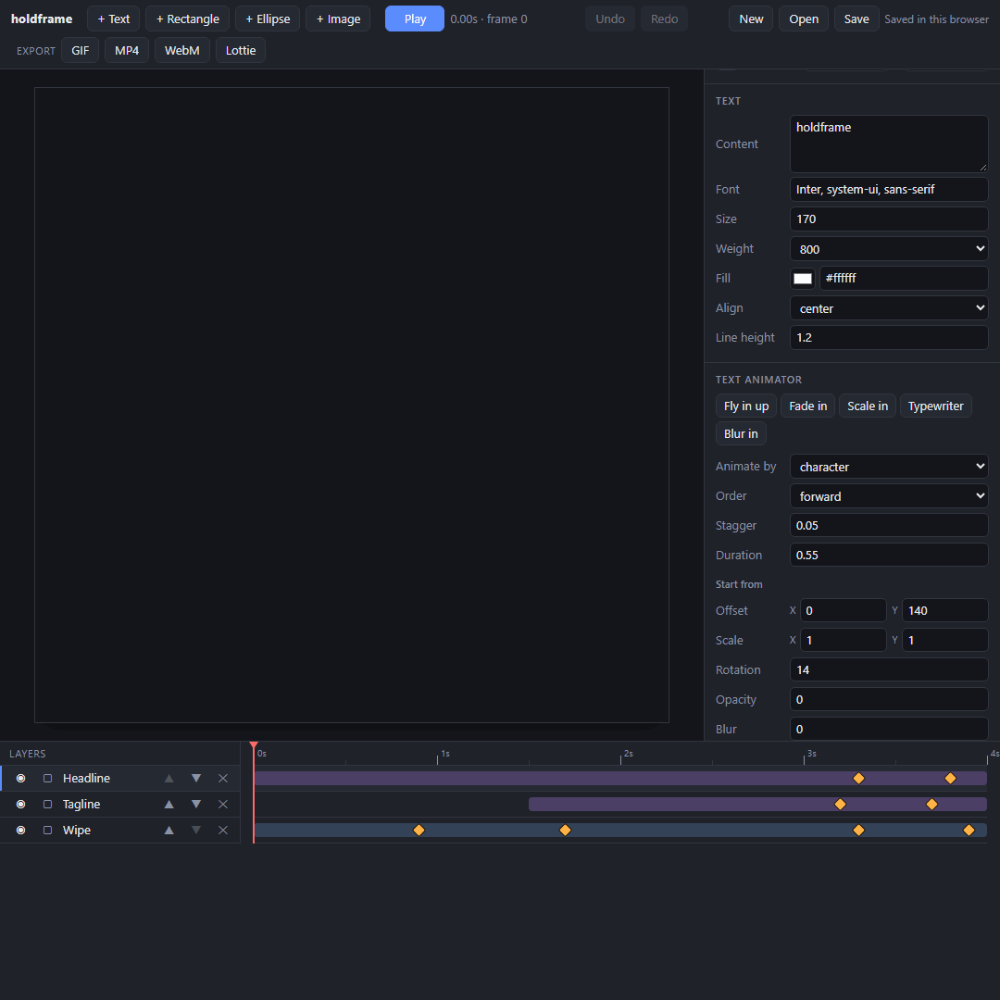

**holdframe** is a browser-based motion graphics editor: no install, no subscription, nothing uploaded.

**Try it: https://mahdialani.github.io/holdframe/**

It is the 10% of After Effects most people actually use, free, in a browser tab, with Lottie export.

## What it does

- **Text animator.** Animate each character, word or line with a delay between them, in forward, reverse or random order. Five presets to start from: fly in up, fade in, scale in, typewriter, blur in.
- **Text, rectangle, ellipse and image layers** with position, scale, rotation, opacity and anchor, five blend modes, and in/out points.
- **Keyframes on every transform and geometry property**, with hold, linear or bezier easing picked from a curve editor. Overshoot is allowed.
- **A timeline** with keyframes as draggable diamonds, frame-accurate scrubbing and playback at the composition frame rate.
- **Undo and redo for everything.**
- **Export** to GIF, MP4, WebM and Lottie JSON.
- **Autosave in your browser**, plus save and open as a single `.holdframe` file with images embedded.

Everything runs locally. There is no backend, no account, and no network request carrying your work.

## What it does not do

These are deliberate, not a to-do list:

3D, expressions or scripting, masks and mattes, an effects library, audio, nested compositions, video layers, motion blur, mesh warp, plugins, collaboration, accounts, or any backend.

If you need those, you need After Effects.

## Lottie export

Export writes a standard Lottie JSON file you can play with [lottie-web](https://github.com/airbnb/lottie-web) or any other Lottie player.

- Shapes, images and transforms export as native Lottie layers with the same keyframes and easing curves you authored.
- Animated text exports as one layer per character, word or line, each with its own staggered keyframes, so the motion matches the editor exactly.
- Images are embedded as data URLs.
- The test suite renders each export in lottie-web and compares it against holdframe's own render.

Known differences:

- lottie-web has no `add` blend mode. It is written with Lottie's own code for it, but lottie-web draws it as normal.
- Text is drawn with the fonts installed on the viewer's machine, not embedded glyphs. Use a font your audience has.
- Lottie fonts carry a named style, not a numeric weight, so weights map to Light, Regular, Medium, Bold or Black.

## Running it locally

Requires Node 22.

```bash
npm install
npm run dev
```

Then open the URL Vite prints.

```bash
npm run build     # static site in dist/
npm test          # typecheck, unit tests, then browser tests
```

The browser tests need Chromium once: `npx playwright install chromium`. Golden-frame references in `tests/golden/` are per platform, because text antialiasing differs between operating systems; the committed set is for Windows.

`npm run demo:record` re-records the GIF above by driving the real editor through `demo/demo.holdframe`, which you can also open in the app.

## How it is built

TypeScript, React, Zustand and Canvas2D, built with Vite. Video encoding uses [mediabunny](https://mediabunny.dev), GIF uses [gifenc](https://github.com/mattdesl/gifenc).

```
src/
  model/    types, project construction, validation, version check
  eval/     evaluate(project, t) -> RenderTree. Pure, no DOM.
  render/   Renderer interface and the Canvas2D implementation
  export/   GIF, video and Lottie writers
  store/    Zustand store and the undo command stack
  ui/       Timeline, Viewport, LayerList, PropertyPanel, Toolbar
  assets/   IndexedDB storage and .holdframe files
```

`eval/` turns a project and a time into a flat list of draw commands and never touches the DOM, so the animation maths is unit tested directly. `render/` only draws that list.

## Browser support

Editing works in any current browser. Blur in the text animator relies on Canvas2D filters, and MP4 and WebM export relies on WebCodecs; both are available in Chromium-based browsers and Firefox. GIF and Lottie export work everywhere.

## License

MIT
